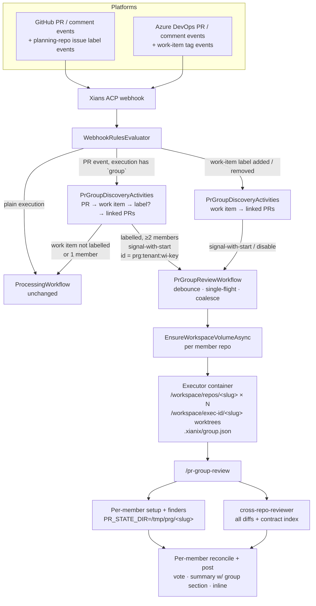
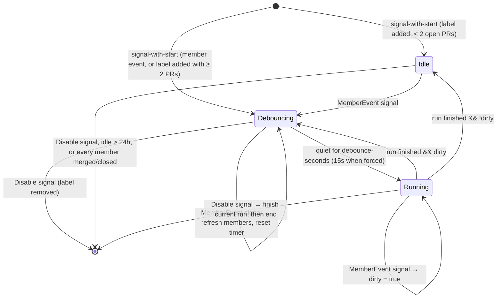

# Multi-PR Group Review — Design

Status: **Proposal (rev 3 — opt-in by work-item label)** · Scope: `the-agent` (control plane + Executor) and `pr-reviewer@xianix-plugins-official` (plugin)

## 1. Problem Statement

Multi-repository coding agents implement one feature as a *set* of pull requests on one platform — e.g. an API change in `org/orders-api`, the consuming UI in `org/web`, a migration in `org/db-schema`, and an IaC change in `org/infra`. Today each of those PRs is reviewed in isolation:

```
webhook (1 PR) → WebhookRulesEvaluator → ProcessingWorkflow → 1 container → 1 repo volume → 1 worktree → /pr-review <n>
```

Every layer assumes exactly one repository and one PR:

| Layer | Single-PR assumption |
|---|---|
| `rules.json` execution | One `repository` binding, one `pr-number` input. |
| `ProcessingWorkflow` | One `EnsureWorkspaceVolumeAsync(tenant, repositoryUrl)`, one container. |
| Executor | One bare clone at `/workspace/repo`, one worktree at `/workspace/exec-<id>`, platform inferred from that one `origin`. |
| `pr-reviewer` plugin | All run state lives in fixed paths (`/tmp/pr_state.env`, `/tmp/pr_full_diff.patch`, `/tmp/pr_inline_findings.jsonl`, … — ~30 distinct files, 500+ references across `commands/`, `scripts/`, `providers/`). |

So the reviewer cannot see the defects that only exist *between* the PRs:

- **Contract drift** — the producer changed a field/route/event/enum; a consumer in another PR wasn't updated (or was updated differently).
- **Missing counterpart** — a breaking change with no matching change anywhere in the group.
- **Ordering hazards** — PR A depends on a migration / config key / package version that only lands in PR B; merging or deploying in the wrong order breaks prod.
- **Cross-repo inconsistency** — different error codes, feature-flag names, env-var names, or validation rules for the same concept.
- **Duplicated logic** — the same helper re-implemented in two repos in the same feature.

Each per-PR review also repeats context the others already have, and the human reviewer receives N unrelated reports instead of one coherent view of the feature.

## 2. Goals and Non-Goals

| Goal | Description |
|---|---|
| **Unified review** | One review run sees every PR in the group and produces cross-repo findings in addition to per-PR findings. |
| **Opt-in once, on the work item** | Group review is switched on by one label (Azure DevOps: tag) on the work item. Member PRs need no label of their own, and PRs linked later are included automatically. |
| **Native per-PR output** | Each PR still gets its own verdict/vote, summary comment, and inline findings, so platform branch policies keep working. |
| **Group view on every PR** | Every member's summary carries the same group section: members, per-PR verdicts, cross-repo findings, recommended merge order. |
| **Re-review continuity** | The existing fid-based re-review (carried-over / fixed / reopened) keeps working per PR. |
| **One platform per group** | A group is either all GitHub or all Azure DevOps. Both platforms are supported, but never mixed in one group. |
| **On-demand re-run** | A human can re-run the group review from any member PR with `@xianix review group`. |
| **No regression** | `/pr-review <n>`, and PRs whose work item is not labelled, behave exactly as today. |
| **Bounded cost** | Group size and diff size are capped; finders stay on the cheap tier by default. |

Non-goals:
- **Mixed-platform groups.** A GitHub PR and an Azure DevOps PR are never reviewed together, even if they reference the same work item.
- **Enforcing merge order.** The recommended merge order is advisory text in the summary only. No platform status check or branch policy is created, now or in a later phase.
- **Groups without a work item.** A group always comes from a labelled work item; PRs that only link each other are reviewed individually.
- Reviewing repos that are *not* in the group (no org-wide consumer search).
- Monorepo "stacked PR" chains.

## 3. Key Decisions (summary)

| # | Decision | Chosen | Main alternative |
|---|---|---|---|
| D1 | How a group is identified | **The shared work item** that the coding agent links to every member PR (Azure DevOps work item, or GitHub issue in a planning repo) | Free-text PR links in descriptions; an explicit manifest (kept only as an exclusion override) |
| D2 | Where membership is resolved | **Control-plane Temporal activity** (`PrGroupDiscoveryActivities`) calling the platform APIs with the execution's already-resolved tokens | A separate `discover` executor container |
| D3 | Trigger semantics | **One debounced, single-flight group workflow per work item** (`prg:<tenant>:<work-item-key>`) | Review on every member event |
| D4 | Workspace shape | **One container, N repo volumes, N worktrees** | Map-reduce: one container per PR + a reducer |
| D5 | Plugin packaging | **New `/pr-group-review` command inside `pr-reviewer`** | Separate `pr-group-reviewer` plugin |
| D6 | Run-state isolation in the plugin | **`PR_STATE_DIR` per member** (default `/tmp`, so single-PR is unchanged) | Copy scripts / run members sequentially |
| D7 | Where cross-repo findings are posted | **Inline on the PR that should change**, with a link to the counterpart, plus listed in the group summary on every member | Summary-only |
| D8 | Manual re-run | **`@xianix review group` comment on any member** signals the same group workflow | Re-push / re-label to trigger |
| D9 | Merge order | **Advisory only**, in the group summary | Platform status check |
| D10 | Platforms in one group | **Single platform** — the triggering PR's platform; members on other platforms are ignored | Mixed GitHub + Azure DevOps groups |
| D11 | How group review is switched on | **One label / tag on the work item** (`ai-dlc/pr/group-review`); checked by discovery, not by the PR rule | A label on every member PR |

The rest of this document explains each.

## 4. Architecture Overview



## 5. Group Identity (D1, D2, D11)

### 5.1 What makes a group

A group exists when **all** of these hold:

1. A work item (Azure DevOps work item, or GitHub issue in the planning repo) carries the **group-review label** — `ai-dlc/pr/group-review` by default, configurable per execution (`group.work-item-label`, §6). On Azure DevOps this is a work-item **tag**.
2. Two or more open PRs on the same platform are linked to that work item.

The members are exactly the open PRs linked to the work item. An **explicit manifest** (`<!-- xianix:pr-group … -->` in a PR description) is kept only as an override to *exclude* a PR that is linked to the work item but should not be reviewed with the others; it cannot add PRs or create a group on its own.

A PR whose work item is not labelled (or that has no work item) is handled by the normal per-PR rules, exactly as today.

**Why the label lives on the work item, not on each PR:** the work item already *is* the group, so one label there opts in the whole feature. It is set once (by the coding agent when it creates or picks up the work item, or by a person), PRs linked later are included without anyone remembering to label them, and removing the label switches the whole group off. A label on every PR makes an incomplete group the most likely failure — one PR unlabelled and silently reviewed alone.

**Label name.** Use the same string on both platforms. Before rollout, confirm Azure DevOps accepts `/` in tag names; if it does not, use `ai-dlc-pr-group-review` everywhere.

### 5.2 Work-item discovery per platform

Discovery has two entry points:

- **From a PR event:** PR → work item(s) → is the label present? → work item → all linked PRs.
- **From a work-item label event:** work item → all linked PRs (the label is already known).

Discovery only runs against the triggering event's platform, using that platform's token.

**Azure DevOps (work item):**

| Step | API |
|---|---|
| PR → work items | `GET {org}/{project}/_apis/git/repositories/{repoId}/pullRequests/{prId}/workitems` |
| Work item → label and linked PRs | `GET {org}/{project}/_apis/wit/workitems/{id}?$expand=relations` — one call returns both. The label is checked in `fields["System.Tags"]` (a `; `-separated string). Linked PRs are relations with `rel == "ArtifactLink"` and `attributes.name == "Pull Request"`. Each URL has the form `vstfs:///Git/PullRequestId/{projectId}%2F{repoId}%2F{prId}`, which decodes to a repo and PR. PRs in any project of the same organisation are found. Relations of other types (e.g. `GitHub Pull Request` from the Azure Boards GitHub integration) are ignored. |

**GitHub (issue in a separate planning repo as the work item):**

On GitHub the work item is an issue in a dedicated **planning repository** (e.g. `acme/planning`), not in any of the member code repos. The planning repo is configured per execution (`group.planning-repository`, §6). It is only read for its issue and its labels; it is never cloned or reviewed.

| Step | API |
|---|---|
| PR → planning issue | Parse the PR body for references to the planning repo: `acme/planning#12` or `https://github.com/acme/planning/issues/12`. Also read GraphQL `pullRequest.closingIssuesReferences` and keep only issues in the planning repo. References to issues in any other repo are ignored, so an unrelated mention can never form a group. |
| Planning issue → label and linked PRs | One GraphQL query: `repository(owner, name: planning).issue(number) { labels(first: 50) { nodes { name } } timelineItems(itemTypes: [CROSS_REFERENCED_EVENT, CONNECTED_EVENT]) { … } }`. Linked PRs are filtered to PRs in the tenant's repos. GitHub records a cross-reference on the issue whenever a PR in another repo mentions it, so every member PR shows up here. |

**Use a non-closing reference.** A closing keyword across repos (`Fixes acme/planning#12`) or a "Development" sidebar link makes GitHub **close the planning issue when the first member PR merges**. Discovery still works on a closed issue, but the feature would look done in planning while other PRs are still open. The coding agent should write a non-closing reference in every member PR, e.g. `Part of acme/planning#12`. Cross-referenced events are created for non-closing mentions too.

**Token access.** The token used for GitHub discovery needs read access to the planning repo's issues, in addition to the member repos (fine-grained PAT: *Issues: Read* and *Metadata: Read* on the planning repo). If it is missing, discovery fails with a clear error and the triggering PR falls back to the normal per-PR rules (§10).

`AB#<id>` references to Azure DevOps work items in a GitHub PR body are not used for grouping.

**Choosing one work item.** The coding agent links every member PR to the **same** work item, so the group is exactly the set of PRs linked to it. No walk up to a parent work item (task → user story → feature) is done. If a PR happens to link several work items, only **labelled** ones are considered; if more than one is labelled, use the one linked to at least one other open PR, and on a tie the lowest id. The others are listed in the group summary as "also linked".

### 5.3 Group key

The work item gives a stable key for the whole life of the feature:

```
azure:  wi:azure:<org>:<work-item-id>        e.g. wi:azure:acme:1234
github: wi:github:<owner>/<repo>#<issue>     e.g. wi:github:acme/planning#87
```

Every member PR, and every label event on the work item, resolves to the same key, so all of them reach the same workflow (§7). This also removes the need for the membership index the link-only design required: there is no "B doesn't link back to A" problem, because B links the work item, not A.

### 5.4 Where discovery runs: `PrGroupDiscoveryActivities` (new, `TheAgent/Activities/`)

```csharp
public sealed record PrGroupMember(string Platform, string RepositoryUrl, string RepositoryName, int PrNumber, string PrUrl, string State, string FoundVia);
public sealed record PrGroup(string GroupKey, string WorkItemUrl, string WorkItemTitle, bool OptedIn, IReadOnlyList<PrGroupMember> Members);

public class PrGroupDiscoveryActivities
{
    // From a PR event. Null when the PR has no work item → normal per-PR rules.
    // OptedIn == false when the work item lacks the label → normal per-PR rules.
    [Activity] public Task<PrGroup?> DiscoverFromPullRequestAsync(PrGroupDiscoveryRequest request);

    // From a work-item label event: the work item is known, only its linked PRs are fetched.
    [Activity] public Task<PrGroup> DiscoverFromWorkItemAsync(WorkItemDiscoveryRequest request);
}
```

- It is a Temporal **activity**, which is the right place for I/O. It is retried on transient HTTP failures and costs a few seconds with no LLM.
- It uses the platform tokens the execution already resolves from tenant secrets (`with-envs` → `secrets.GITHUB-TOKEN` / `secrets.AZURE-DEVOPS-TOKEN`), so no new credentials are introduced. Tokens are passed to the HTTP client only and never logged.
- **Why not a `discover` executor container** (suggested in the link-based iteration): work-item discovery is two or three REST calls. A container start per PR event would cost more than the work it does, and every Azure DevOps review event needs discovery because neither the PR webhook payload nor the PR rule can see the work item's labels.
- URL parsing and normalisation (`vstfs://` decoding, issue refs, PR URLs, `System.Tags` splitting) live in a pure static helper, `PrGroupResolver`, so they can be unit-tested without HTTP.

### 5.5 Safety rules

Work-item links and PR links are written by people, so discovery treats them as untrusted input:
- Only accept member PRs on the triggering event's platform. A PR on the other platform is dropped and listed as `other platform` in the summary.
- Only accept member PRs in repos that belong to this tenant (onboarded, or matching the tenant's org allow-list). Never follow a link into another tenant or an arbitrary public repo.
- PRs the token cannot read are skipped and listed as `no access` in the summary. They do not fail the run.
- Closed PRs are dropped. Merged PRs are listed as context and not reviewed.
- Hard caps: `max-members` (default 6), at most 3 work items examined per PR, at most 50 relations read per work item.

## 6. Configuration Surface (`rules.json`)

There are two kinds of executions:

1. **The existing PR review executions** gain an optional `group` block. On each PR event they run discovery, which decides between a group review and the normal single-PR review.
2. **New work-item label executions** react to the label being added or removed on the work item (§6.1).

### 6.0 PR review executions

```jsonc
{
  "name": "azuredevops-pull-request-review",
  "platform": "azuredevops",
  "repository": { "url": "resource.repository.remoteUrl" },
  "match-any": [ /* unchanged: created / source branch updated / agent added as reviewer */ ],
  "use-inputs": [ { "name": "pr-number", "value": "resource.pullRequestId", "mandatory": true } ],
  "group": {
    "work-item-label": "ai-dlc/pr/group-review",     // the opt-in label / tag (§5.1)
    "pr-text": "resource.description",               // JSON path to the PR description (manifest override)
    "debounce-seconds": 180,                         // quiet period before a group run
    "max-members": 6,
    "max-total-diff-lines": 6000,                    // above this the plugin degrades (§9.4)
    "group-prompt": "You are reviewing the pull-request group for work item {{work-item-title}} ({{group-size}} PRs). Run /pr-group-review to perform the unified review."
  },
  "use-plugins": [
    { "plugin-name": "pr-reviewer@xianix-plugins-official", "marketplace": "xianix-team/plugins-official" }
  ],
  "with-envs": [
    { "name": "AZURE-DEVOPS-TOKEN", "value": "secrets.AZURE-DEVOPS-TOKEN", "mandatory": true }
  ],
  "model": "claude-sonnet-5",
  "max-budget-usd": 5,                    // per member for group runs (§11)
  "execute-prompt": "You are reviewing pull request #{{pr-number}} in the repository {{repository-name}}. Run /pr-review {{pr-number}} to perform the automated review."
}
```

**Outcome of discovery on a PR event:**

| Work item labelled? | Members | PR matched one of its own per-PR triggers? | Result |
|---|---|---|---|
| Yes | ≥ 2 | any | **Group review**: signal `PrGroupReviewWorkflow`. Any single-PR review of this PR is suppressed. |
| Yes | 1 | any | **Single-PR review** with `execute-prompt` (becomes a group review once a second PR links the work item, §7). |
| No / no work item | — | Yes | **Single-PR review**, exactly as today. |
| No / no work item | — | No | Ignored. |

**GitHub needs one extra kind of trigger.** Today the GitHub review execution only matches PRs carrying the per-PR label `ai-dlc/pr/pr-review`. Member PRs of a labelled work item don't need that label, so the execution also matches PR events that reference the planning repo. Those entries are marked `requires-group: true`: when only such an entry matched, the event counts **only if** discovery finds a labelled work item; otherwise it is ignored rather than reviewed alone.

```jsonc
"match-any": [
  /* unchanged per-PR triggers: labelled / opened-with-label / synchronize-with-label */
  { "name": "github-pr-group-candidate-opened", "requires-group": true,
    "rule": "action==opened&&pull_request.body*='acme/planning#'&&pull_request.state=='open'" },
  { "name": "github-pr-group-candidate-sync",   "requires-group": true,
    "rule": "action==synchronize&&pull_request.body*='acme/planning#'&&pull_request.state=='open'" },
  { "name": "github-pr-group-candidate-edited", "requires-group": true,
    "rule": "action==edited&&pull_request.body*='acme/planning#'&&pull_request.state=='open'" }
],
"group": {
  "work-item-label": "ai-dlc/pr/group-review",
  "planning-repository": "acme/planning",            // required on GitHub (§5.2)
  "pr-text": "pull_request.body",
  /* debounce-seconds, max-members, max-total-diff-lines, group-prompt as above */
}
```

with only `GITHUB-TOKEN` in `with-envs`. The `edited` entry means adding `Part of acme/planning#12` to a description re-evaluates the group. Azure DevOps needs no extra entries: its per-PR triggers already match every active PR.

Other notes:
- The group's platform is the execution's `platform`, so each review execution only ever produces groups on its own platform.
- `RulesSchemaValidator` gains the `group` schema and the `requires-group` flag on `match-any` entries; `WebhookRulesModels.WebhookExecution` gains `Group`. `WebhookRulesEvaluator` already knows which `match-any` entry matched; it now also reports whether every matching entry was `requires-group`.
- New auto-injected inputs for group runs: `group-key`, `group-size`, `group-members` (JSON array), `work-item-url`, `work-item-title`.
- `conversation-key` defaults to `group-key` for group runs, so `resume-sessions` resumes the group's prior session rather than one member's.

### 6.1 Work-item label executions (D11)

One execution per platform reacts to the label itself. These executions have **no `repository`**: a work-item event has no repo to clone, and on GitHub the event's repository is the planning repo, which must not be cloned. The member repos come entirely from discovery. (The existing Azure DevOps requirement-analysis execution already runs without a `repository`, so this shape is supported.)

```jsonc
{
  "name": "github-work-item-group-review-label",
  "platform": "github",
  "match-any": [
    { "name": "github-issue-group-label-added",
      "rule": "action==labeled&&label.name=='ai-dlc/pr/group-review'&&repository.full_name=='acme/planning'" },
    { "name": "github-issue-group-label-removed",
      "rule": "action==unlabeled&&label.name=='ai-dlc/pr/group-review'&&repository.full_name=='acme/planning'" }
  ],
  "use-inputs": [ { "name": "work-item-number", "value": "issue.number", "mandatory": true },
                  { "name": "work-item-action", "value": "action", "mandatory": true } ],
  "group": { "trigger": "work-item", "work-item-label": "ai-dlc/pr/group-review",
             "planning-repository": "acme/planning" /* + the same tuning as the PR execution */ },
  "with-envs": [ { "name": "GITHUB-TOKEN", "value": "secrets.GITHUB-TOKEN", "mandatory": true } ]
}
```

```jsonc
{
  "name": "azuredevops-work-item-group-review-tag",
  "platform": "azuredevops",
  "match-any": [
    { "name": "azuredevops-workitem-group-tag-added",
      "rule": "eventType==workitem.updated&&resource.fields.\"System.Tags\".newValue*='ai-dlc/pr/group-review'&&resource.fields.\"System.Tags\".oldValue!*='ai-dlc/pr/group-review'" },
    { "name": "azuredevops-workitem-group-tag-removed",
      "rule": "eventType==workitem.updated&&resource.fields.\"System.Tags\".oldValue*='ai-dlc/pr/group-review'&&resource.fields.\"System.Tags\".newValue!*='ai-dlc/pr/group-review'" }
  ],
  "use-inputs": [ { "name": "work-item-id", "value": "resource.workItemId", "mandatory": true } ],
  "group": { "trigger": "work-item", "work-item-label": "ai-dlc/pr/group-review" /* + tuning */ },
  "with-envs": [ { "name": "AZURE-DEVOPS-TOKEN", "value": "secrets.AZURE-DEVOPS-TOKEN", "mandatory": true } ]
}
```

- **Label added:** `DiscoverFromWorkItemAsync`, then signal-with-start the group workflow. With 0 or 1 open PRs the workflow just idles; the first (or second) PR event starts the review.
- **Label removed:** signal `Disable` to the group workflow, if one is running. It ends without running; later PR events go through the normal per-PR rules again.
- `group.trigger: "work-item"` tells the dispatcher to skip PR → work item discovery and to route to the group workflow only, never to `ProcessingWorkflow`.
- `group.tuning` (model, budget, `group-prompt`, caps) must match the PR executions' `group` block. To avoid drift, the PR execution's block is the single source: the work-item execution refers to it by name (`"group": { "trigger": "work-item", "use-group-of": "github-pull-request-review" }`). The validator rejects a reference to a missing execution.

**Webhook setup this needs:**
- **GitHub:** the **planning repo** must send `issues` events to the Xians webhook. Today only code repos send events.
- **Azure DevOps:** a `workitem.updated` service hook for the project, which already exists for `req-analyst`.

### 6.2 `@xianix review group` (D8)

A new comment execution per platform, matching a comment on any PR that contains `@xianix review group`:

```jsonc
{ "name": "github-pr-group-review-requested",
  "rule": "action==created&&issue.pull_request?&&comment.body*='@xianix review group'" }
{ "name": "azuredevops-pr-group-review-requested",
  "rule": "eventType==ms.vss-code.git-pullrequest-comment-event&&resource.comment.content*='@xianix review group'" }
```

- It runs discovery for that PR. If the work item is labelled, it signals the group workflow with `force = true`: a short 15-second debounce instead of the normal quiet period, and members are re-reviewed even if their HEAD has not moved (§9.7).
- If the PR has no labelled work item, it replies once and does nothing else: "Group review isn't enabled for this PR. Add the `ai-dlc/pr/group-review` label to the work item it's linked to." The comment does not enable group review by itself; the label stays the single switch.
- The existing generic `@xianix` comment executions get `&&comment.body!*='review group'` (GitHub) and `&&resource.comment.content!*='review group'` (Azure DevOps), so the same comment is not also handled as a free-form instruction. `!*=` is already supported by `WebhookRulesEvaluator`.

## 7. Control Plane: `PrGroupReviewWorkflow` (D3)

Members are opened minutes apart and each pushes independently. Reviewing on every event would produce N partial reviews and N× cost. The workflow is therefore keyed by the work item, not the event:

```
workflowId = "prg:" + tenantId + ":" + groupKey      // e.g. prg:acme-tenant:wi:azure:acme:1234
```



- **Signal-with-start** gives single-flight and coalescing for free. If the Xians `XiansContext.Workflows` wrapper does not expose signal-with-start, use start-with-deterministic-ID and, on `WorkflowAlreadyStarted`, signal the running instance — same semantics.
- **Member refresh.** Each signal carries the latest discovery result. Just before running, the workflow calls `DiscoverFromWorkItemAsync` once more, so a PR linked to the work item while it was waiting is picked up — and a label removed while waiting is noticed (the run is skipped).
- **Disable.** On a `Disable` signal (label removed) the workflow ends. A run already in progress finishes and posts; nothing new starts.
- **Run.** For each member: `EnsureWorkspaceVolumeAsync(tenant, member.RepositoryUrl)` (existing activity, unchanged), then one `StartContainerAsync` with all volumes mounted (§8). Output parsing, metrics (`ReportExecutionMetricsAsync`) and cleanup are reused from `ProcessingWorkflow` — extract them into a shared static helper rather than duplicating.
- **Continue-as-new** after each completed run keeps history small for long-lived groups.
- `WebhookDeduplicationGuard` still runs first; it removes platform double-deliveries before they become signals.
- **Single PR that later becomes a group.** A PR reviewed alone (only PR on its labelled work item, or reviewed before the label was added) is reviewed again as part of the group once the group forms. Its earlier inline findings are reconciled by fid, so nothing is posted twice.

## 8. Executor: Multi-Repo Workspace (D4)

### 8.1 Inputs

`XIANIX-INPUTS` gains a `repositories` array (present only for group runs):

```json
{
  "group-key": "wi:azure:acme:1234",
  "platform": "azuredevops",
  "work-item-url": "https://dev.azure.com/acme/shop/_workitems/edit/1234",
  "repositories": [
    { "slug": "orders-api", "url": "https://dev.azure.com/acme/shop/_git/orders-api", "pr-number": 41 },
    { "slug": "web",        "url": "https://dev.azure.com/acme/shop/_git/web",        "pr-number": 88 },
    { "slug": "db-schema",  "url": "https://dev.azure.com/acme/shop/_git/db-schema",  "pr-number": 12 }
  ]
}
```

### 8.2 Layout

```
/workspace/repos/<slug>/          ← each member's existing tenant+repo volume (bare clone), mounted rw
/workspace/exec-<id>/             ← cwd for Claude Code
    <slug>/                       ← one detached worktree per member (default-branch HEAD)
    .xianix/group.json            ← the inputs above + resolved worktree paths
```

- `ContainerActivities.StartContainerAsync` mounts one bind per member volume instead of the single `/workspace/repo`. Volume naming, labels and per-tenant isolation are unchanged — a group can only include repos of the same tenant, because volumes are tenant-scoped.
- `prepare_repo.sh` loops `ensure_bare_repo` / default-branch pull / `worktree add` over `repositories[]`. The single-repo path is the 1-element case, so the existing code becomes a function rather than being forked.
- `platform` is set once for the whole group, so `configure_credentials` runs unchanged — one credential helper, one token.
- `generate_context.sh` runs per worktree; the cached `CLAUDE.md` of each member is reachable at `<slug>/CLAUDE.md`.
- Two PRs in the *same* repo are allowed: they share one volume and get two worktrees (`<slug>`, `<slug>-2`).

**Why one container rather than map-reduce:** the cross-repo reviewer's value comes from one model context seeing both sides of a contract at once. Groups are small (2–6 PRs), and per-repo volumes already make clones cheap. Map-reduce (one container per PR emitting an "interface digest", then a reducer) is the fallback design for very large groups; §9.4 gets most of its benefit inside the single container.

## 9. Plugin: `/pr-group-review` (D5, D6, D7)

### 9.1 Packaging

A new command in the existing plugin, not a new plugin. `pr-reviewer` holds ~8k lines of hard-won scripts (permissions, checkout gates, line validation, fid assignment, Gate A/B reconciliation, ADO thread properties, marker verification) that the group command must reuse verbatim. A separate plugin would fork them.

New files:

| File | Purpose |
|---|---|
| `commands/pr-group-review.md` | The group procedure (below). |
| `agents/cross-repo-reviewer.md` | Frontier-tier reviewer for inter-PR defects. |
| `scripts/group-setup.sh` | Reads `.xianix/group.json` (or CLI args), runs per-member permissions → start comment → `pr-setup.sh` → `detect-review-mode.sh` with `PR_STATE_DIR` set, writes `/tmp/prg/group_state.env`. |
| `scripts/group-contract-index.sh` | Deterministic, token-free extraction of *changed interface surface* per member into `/tmp/prg/contracts.md`. |
| `scripts/group-route-findings.sh` | Splits the lead's combined findings into each member's `${PR_STATE_DIR}/pr_inline_findings.jsonl`. |
| `scripts/group-post.sh` | Runs `validate-findings` → `assign-fids` → `reconcile-prior-findings` → `gh-/ado-post-review` per member. |
| `styles/group-report-template.md` | The group section appended to each member's summary. |

The plugin does **not** do discovery or check the label in a group run; it trusts `.xianix/group.json` from the control plane. Discovery logic exists once, in C# (§5.4).

### 9.2 Prerequisite refactor: `PR_STATE_DIR` (Phase 0, no behaviour change)

Every script resolves its state root once:

```bash
PR_STATE_DIR="${PR_STATE_DIR:-/tmp}"
# /tmp/pr_state.env → ${PR_STATE_DIR}/pr_state.env, etc.
```

and `commands/pr-review.md` / `providers/*.md` reference `${PR_STATE_DIR}/pr_…`. With the variable unset, every path is byte-identical to today, so `/pr-review` is unaffected. `scripts/tests/run.sh` gets a case that runs the setup → reconcile chain twice with two state dirs and asserts no file crosses over. This is a mechanical change but touches most scripts, so it ships alone.

Scripts that `git remote get-url origin` already work per member as long as they run with `cwd` = that member's worktree; `group-setup.sh` / `group-post.sh` `cd` into it for each member.

### 9.3 Procedure

```
G0  Resolve plugin scripts (same helper as /pr-review step 0)
G1  bash group-setup.sh
      for each member (cwd = /workspace/exec-<id>/<slug>, PR_STATE_DIR=/tmp/prg/<slug>):
        check-permissions → start comment ("Group review in progress — work item <id>, N PRs")
        pr-setup.sh (checkout PR head; hard gate on HEAD_SHA)
        detect-review-mode.sh (initial vs re-review, open threads)
      member that fails permissions or is closed/merged → excluded, recorded in group_state.env
G2  bash group-contract-index.sh → /tmp/prg/contracts.md
G3  Per-member tier (review-tier.sh per member) — unchanged logic
G4  Fan-out, ALL in one assistant turn (sub-agents cannot nest):
      per member: the 6A Haiku finders or 6B specialists, prompts pointing at that member's state dir
      once:       cross-repo-reviewer (only when ≥2 members changed)
G5  Lead self-verifies, writes /tmp/prg/findings.jsonl with a `member` field on every finding
G6  bash group-route-findings.sh → per-member pr_inline_findings.jsonl
G7  Compile per-member report body = normal report-template + group section
G8  bash group-post.sh (per member: validate → assign-fids → reconcile → post)
G9  Print one confirmation line per member plus a group line
```

The work item's title and description are passed to the lead and to the cross-repo reviewer as the feature's stated intent. That is what lets the reviewer judge whether a contract change was intended (§9.5).

Fan-out budget: with 6 members the 6A path issues 12 Haiku finders + 1 cross-repo reviewer in one turn. `max-members` keeps this bounded; above 4 members, members on the Haiku tier use a single combined finder each instead of two.

### 9.4 Cross-repo context: the contract index

The cross-repo reviewer cannot read six full diffs plus surrounding code cheaply. `group-contract-index.sh` extracts, per member, only the **changed** lines (from `pr_full_diff_numbered.patch`, so line numbers stay copyable) that touch interface surfaces, plus the matching *unchanged* definitions/usages found by `git grep` in the **other members' worktrees**:

| Surface | Detected by |
|---|---|
| HTTP routes / OpenAPI / GraphQL / proto | file globs (`*.proto`, `openapi*.y*ml`, `*.graphql`) + route attribute/decorator patterns |
| DTOs / public types | exported/public type declarations in changed hunks; names grepped across other members |
| Events / topics / queues | string literals near publish/subscribe calls |
| Config & feature flags | env-var names, `appsettings*.json` / `.env*` keys, flag identifiers |
| DB schema | migration files, ORM entity changes |
| Package versions | manifest changes (`package.json`, `*.csproj`, `go.mod`, …) incl. internal packages published by another member |

This is regex-based and intentionally over-inclusive; the reviewer does the judgement. If the group exceeds `max-total-diff-lines`, the per-member finders still run on full diffs, but the cross-repo reviewer gets only the contract index (not full diffs) — the in-container equivalent of map-reduce.

### 9.5 `cross-repo-reviewer` output

Same block format as the existing finders, with two extra fields:

```
MEMBER: orders-api                 # where the fix belongs (anchor)
FILE: src/Orders/OrderDto.cs
LINE: 42
SEVERITY: CRITICAL
CATEGORY: contract-drift | missing-counterpart | ordering-hazard | inconsistency | duplication
ISSUE: `OrderDto.totalAmount` renamed to `total`, but web still reads `totalAmount`.
RELATED: web:src/api/orders.ts:118
```

Rules given to the agent: anchor on the side that should change (producer for an unintended break, consumer for an intended one — decided from the work item and PR descriptions); never report intra-PR issues (the per-member finders own those); `ordering-hazard` findings must name the required order.

### 9.6 Posting and markers (D7, D9)

- **Per-member findings** post exactly as today.
- **Cross-repo findings** post inline on the `MEMBER` PR. The body ends with `Related: <counterpart PR URL>#<file>:<line>`, so reviewers can jump across. They go through the same `validate-findings` / `assign-fids` / reconcile chain, so re-review resolves them when fixed. Their fid is computed on the anchor line like any other finding, which keeps the v1.2 marker format unchanged. A `category=cross` attribute is appended *after* the existing fields so the current marker regex still matches.
- **Group summary.** Each member's summary comment = its normal report + a group section from `styles/group-report-template.md`:

  ```markdown
  ## Group review · work item [#1234 Checkout v2](https://dev.azure.com/acme/shop/_workitems/edit/1234) (3 PRs)
  | PR | Verdict | Critical | Warnings | Status |
  |---|---|---|---|---|
  | orders-api!41 | REQUEST CHANGES | 1 | 2 | reviewed @ a1b2c3d |
  | web!88 (this PR) | COMMENT | 0 | 1 | reviewed @ 9f8e7d6 |
  | db-schema!12 | APPROVE | 0 | 0 | reviewed @ 44aa01e |

  ### Cross-repo findings
  - 🔴 contract-drift — orders-api `OrderDto.cs:42` ↔ web `orders.ts:118`
  ### Suggested merge order (advisory)
  db-schema → orders-api → web  (migration adds column read by orders-api)

  _Group review is on because work item #1234 has the `ai-dlc/pr/group-review` label. Re-run with `@xianix review group` on any of these PRs; remove the label to switch it off._
  ```

  It carries an additional hidden marker `<!-- pr-reviewer:v1.2 kind=group-summary group=<group-key> sha=<HEAD_SHA> -->` (Azure DevOps: thread property `pr-reviewer.group`). `detect-review-mode.sh` already keys re-review on `kind=summary`/`finding`; the group marker is additive.
- **Merge order is advisory.** It appears only as text in the summary. The plugin creates no status check and sets no policy, and the order never affects any member's vote.
- **Verdicts.** Each member's vote reflects its own findings plus cross-repo findings anchored on it. The group verdict (worst member) is shown in the group section only. `PR_REVIEWER_BLOCK_ON_CRITICAL` applies per member as today.

### 9.7 Re-review

Each member keeps its own prior-findings / Gate A / Gate B reconciliation in its own state dir. On a group re-run:

- Members whose HEAD has **not** moved since their last group summary `sha` skip their finders (Gate A already prevents false "fixed"); their findings are carried over and only the group section is refreshed — edit-in-place of the summary comment rather than a new comment, to avoid notification noise. A forced run (`@xianix review group`) re-runs the finders for every member.
- The cross-repo reviewer re-runs whenever **any** member moved, or the member set changed, because a fix in one repo can resolve or create a cross finding anchored in another.

### 9.8 Running it by hand / from chat

`/pr-group-review` also accepts explicit members, for local use and for the chat path:

```
/pr-group-review https://github.com/acme/orders-api/pull/41 https://github.com/acme/web/pull/88
```

Without `.xianix/group.json`, `group-setup.sh` expects each repo to be checked out as a sibling directory under cwd (named by repo), which is how a developer would run it locally. Explicit members bypass the label check — a person running the command by hand has opted in. For chat, `RunClaudeCodeOnRepository` gains an optional `workItemUrl` parameter (the supervisor calls `DiscoverFromWorkItemAsync`) and the chat rule set lists `"slash-command": "/pr-group-review"` (Phase 3).

## 10. Failure Modes

| Situation | Behaviour |
|---|---|
| PR has no work item | Normal per-PR rules, exactly as today. |
| Work item is not labelled | Normal per-PR rules, exactly as today (on GitHub, a PR matched only by a `requires-group` entry is ignored). |
| Label added before any PR exists | Group workflow starts and idles; the first PR events start the review. |
| Labelled work item linked to only one open PR | Single-PR review now; group review once a second PR links the same work item (§7). |
| Label removed | Group workflow ends after any in-progress run; later PR events use the normal per-PR rules. |
| Label removed and re-added | A new group workflow starts; prior findings are reconciled by fid, so nothing is re-posted. |
| PR links several work items | Only labelled ones count; among those, the one shared with another open PR wins; ties → lowest id; others listed as "also linked" (§5.2). |
| Work item links a PR that is not open yet | Not a member yet; the next event from that PR re-runs the group. |
| Member PR merged/closed | Excluded from finders; listed as `merged`/`closed`. Cross-repo reviewer still sees its *merged* code on the default branch for context. |
| No permission on one member | That member is excluded and listed as `no access` in the other members' summaries; review continues. |
| Member repo not onboarded for the tenant but in an allowed org | Lazy-cloned like chat runs (existing behaviour) — the volume is created on first use. |
| Work item links a repo outside the tenant | Rejected by discovery; logged, not reviewed (§5.5). |
| Work item links a PR on the other platform | Dropped; listed as `other platform` in the summary (§5.5). |
| Group > `max-members` | First `max-members` (by PR creation time) are reviewed; the rest are listed as `skipped (limit)`. |
| Planning issue already closed (GitHub) | Still used as the group key; closed state does not affect discovery. |
| Planning repo has no webhook (GitHub) | Label add/remove events are missed, but PR events still check the label through discovery, so the group still forms on the next push; it just doesn't start the moment the label is added. |
| Token cannot read the planning repo (GitHub) | Discovery fails with a clear error naming the missing access; the triggering PR follows the normal per-PR rules, plus a warning line if it is reviewed. |
| Discovery API fails | Activity retries; after retries are exhausted, the triggering PR follows the normal per-PR rules, with a warning line in its summary if it is reviewed. |
| Budget exhausted mid-run | Per-member posting happens in member order inside `group-post.sh`, so members already posted keep their reviews; the confirmation lines report which did not. |
| `@xianix review group` on a PR without a labelled work item | One reply explaining how to enable group review; nothing else runs. |

## 11. Cost

Rough model per run for a 3-PR group, each ~300 diff lines, default tier:

| Component | Count | Model |
|---|---|---|
| Discovery | 2–4 REST calls | none |
| Lead (orchestration, verify, compile) | 1 | `model` from rules (Sonnet) |
| Per-member finders | 3 × 2 | Haiku |
| Cross-repo reviewer | 1 | lead's model |

Compared with three independent `/pr-review` runs, the group run removes two lead sessions (one lead instead of three) and adds one frontier reviewer — expected to be cost-neutral to slightly cheaper, with debouncing removing the extra reviews that partial groups currently trigger. `max-budget-usd` on a group execution is per member; the workflow passes `min(perMember × N + perMember, hard cap)` to the container.

Because the label is on the work item, discovery runs on **every** PR event the review executions match (on GitHub, also every PR event that references the planning repo), not only on labelled PRs. That is the price of not labelling each PR: 2–3 REST calls per event, with no LLM and no container.

## 12. Implementation Plan

| Phase | Repo | Deliverable | Ships independently? |
|---|---|---|---|
| **0** | plugins-official | `PR_STATE_DIR` refactor + isolation test in `scripts/tests/run.sh` | Yes — no behaviour change |
| **1** | plugins-official | `/pr-group-review`, `cross-repo-reviewer`, group scripts/template. Driven by explicit PR URLs over sibling checkouts — testable locally with no agent changes. | Yes |
| **2a** | the-agent | Executor multi-repo workspace (`repositories[]`, multi-volume mounts, per-member worktrees, `.xianix/group.json`) + integration test in `Executor/tests` | Yes (unused until 2b) |
| **2b** | the-agent | `PrGroupResolver` (pure parsing incl. `System.Tags`, unit tests) + `PrGroupDiscoveryActivities` (`DiscoverFromPullRequestAsync`, `DiscoverFromWorkItemAsync`) for Azure DevOps work items and GitHub planning issues, including the label check | Yes (unused until 2c) |
| **2c** | the-agent | `group` rule schema (incl. `work-item-label`, `requires-group`, `trigger: work-item`, `use-group-of`), `PrGroupReviewWorkflow` (debounce / single-flight / coalesce / disable), work-item label executions for both platforms, `@xianix review group` comment executions and the `!*='review group'` guard on the generic comment executions, `rules.json` updates for GitHub and Azure DevOps | Yes |
| **2d** | coding agent | Link every PR it opens to the feature's one work item (an Azure DevOps artifact link, or on GitHub a non-closing `Part of <owner>/<planning-repo>#n` reference in the PR body), and add the `ai-dlc/pr/group-review` label to that work item once | Required for automatic grouping |
| **2e** | ops | GitHub: add a webhook on the planning repo for `issues` events. Azure DevOps: confirm the `workitem.updated` service hook covers the projects in use, and that `/` is allowed in tag names | Required for label events |
| **3** | both | Chat path (`workItemUrl`); re-run on `workitem.updated` (Azure DevOps) or planning-issue events (GitHub) when a PR is linked or unlinked | — |

## 13. Decisions and Open Questions

Decided (rev 2–3):

| Question | Decision |
|---|---|
| Does the coding agent already link its PRs? | **Yes — through a shared work item.** That is the only grouping source (§5). The manifest is kept only to exclude a PR. |
| Manual group re-run from a comment? | **Yes** — `@xianix review group` on any member (§6.2). Needs the work item to be labelled. |
| Cross-links between GitHub and Azure DevOps in mixed groups? | **Not applicable** — groups are single-platform (D10). Superseded the earlier "acceptable" answer. |
| Merge order as a platform status check? | **No** — advisory text only, permanently (§2, §9.6). |
| Same work item, or child tasks of one story? | **Same work item.** No parent walk (§5.2). |
| Where does the GitHub issue live? | **A separate planning repo**, configured as `group.planning-repository`. PRs use a non-closing `Part of …` reference; the token needs issue read access on that repo (§5.2). |
| Label on every PR, or on the work item? | **On the work item** (D11). One label / tag `ai-dlc/pr/group-review` opts in the whole group; member PRs need no label; removing it switches group review off (§5.1, §6.1). |
| Groups from PR-to-PR links without a work item? | **Dropped.** With the opt-in on the work item, a group needs a labelled work item. |

No open questions remain.
